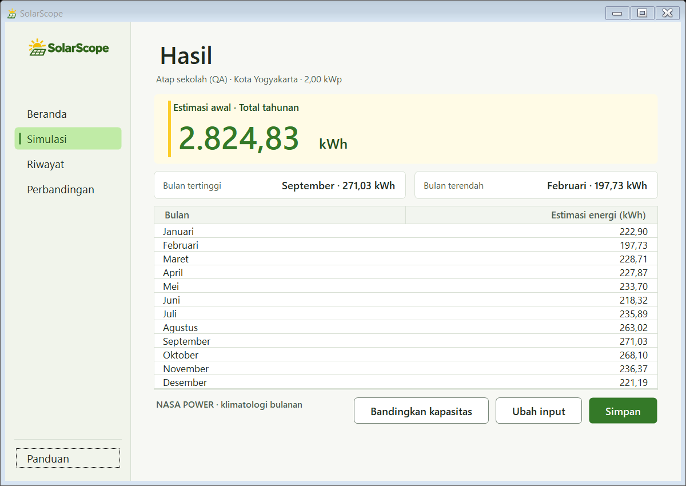
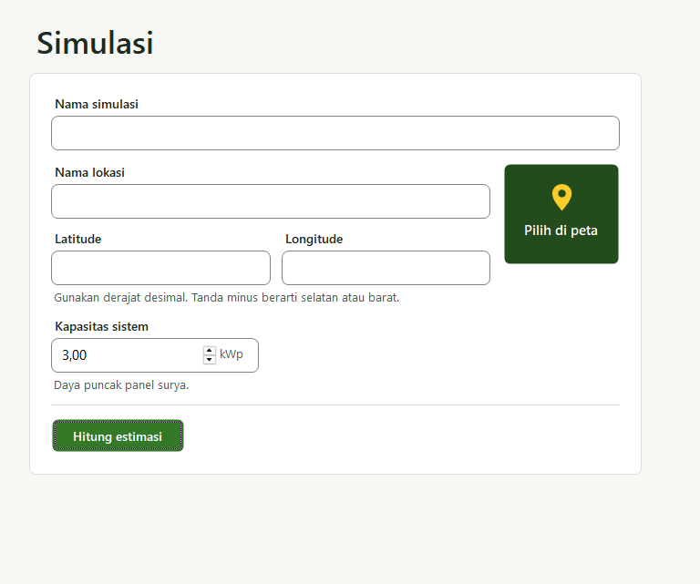
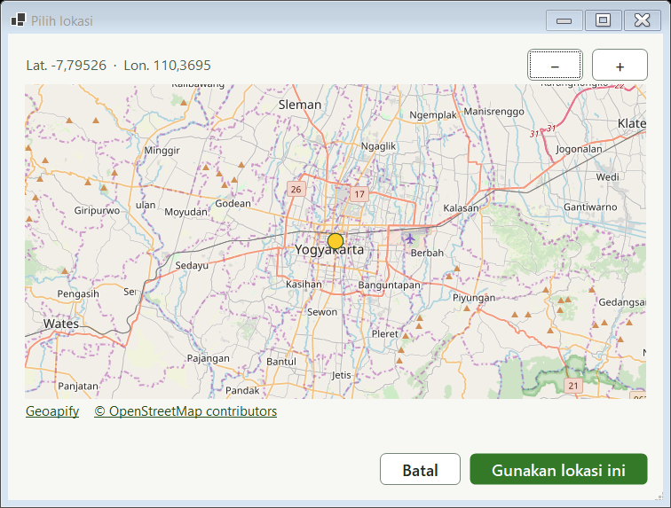
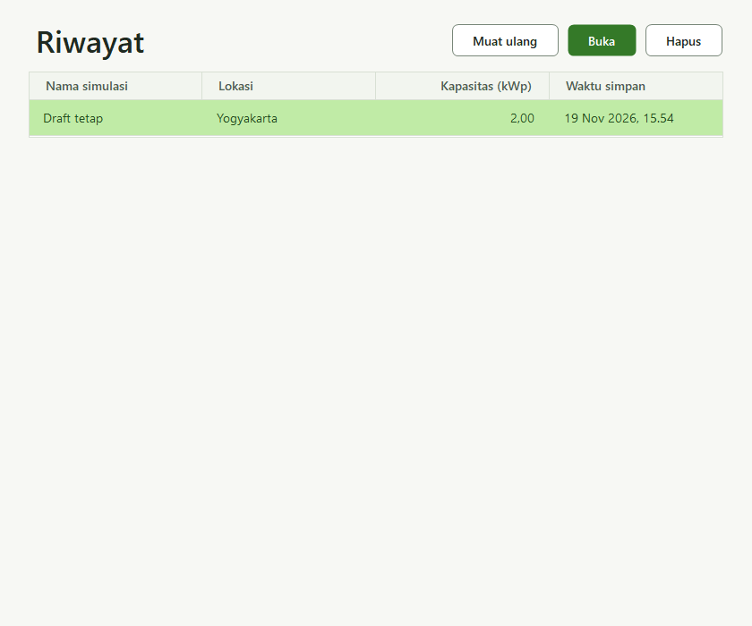
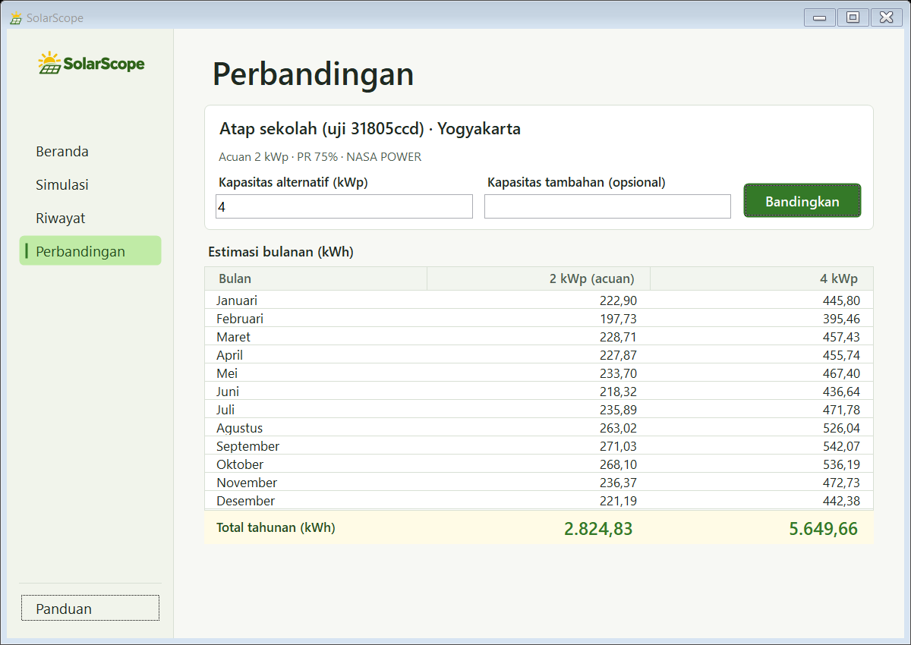

<p align="center">
  
</p>

<h3 align="center">Estimasi awal energi surya berdasarkan lokasi dan kapasitas panel</h3>

SolarScope adalah aplikasi desktop Windows untuk membantu rumah tangga, sekolah, dan usaha kecil memperkirakan produksi energi panel surya. Pilih lokasi di peta atau masukkan koordinat, isi kapasitas sistem, lalu lihat estimasi energi bulanan dan tahunan dari data radiasi NASA POWER.

Hasil bisa disimpan ke Riwayat dan dibuka kembali. Dari satu hasil, pengguna juga bisa membandingkan dua atau tiga kapasitas pada lokasi dan data radiasi yang sama.

Proyek mata kuliah **Junior Project** dengan tema **Climate Action**.

<p align="center">
  <a href="#screenshot">Screenshot</a> ·
  <a href="#fitur">Fitur</a> ·
  <a href="#cara-kerja">Cara kerja</a> ·
  <a href="#tech-stack">Tech stack</a>
  <br />
  <a href="#menjalankan-lokal">Menjalankan lokal</a> ·
  <a href="#pengujian">Pengujian</a> ·
  <a href="#struktur-repositori">Struktur repositori</a> ·
  <a href="#batasan">Batasan</a> ·
  <a href="#tim">Tim</a>
</p>

---

## Screenshot

### Hasil estimasi

<p align="center">
  <a href="docs/screenshots/solarscope-estimate-yogyakarta.png">
    
  </a>
</p>

<table>
  <tr>
    <th width="50%">Simulasi</th>
    <th width="50%">Pemilihan lokasi di peta</th>
  </tr>
  <tr>
    <td valign="top"><a href="docs/map-picker-button.png"></a></td>
    <td valign="top"><a href="docs/screenshots/solarscope-map-yogyakarta.png"></a></td>
  </tr>
  <tr>
    <th>Riwayat</th>
    <th>Perbandingan kapasitas</th>
  </tr>
  <tr>
    <td valign="top"><a href="docs/history-result.png"></a></td>
    <td valign="top"><a href="docs/comparison-result.png"></a></td>
  </tr>
</table>

---

## Fitur

| Fitur | Yang bisa dilakukan |
| --- | --- |
| Pilih lokasi | Isi latitude dan longitude secara manual, atau pasang pin di peta untuk mengisi koordinat dan nama wilayah. |
| Hitung estimasi | Masukkan kapasitas sistem dalam kWp untuk mendapatkan estimasi energi bulanan dan tahunan dalam kWh. Ringkasan juga menampilkan bulan tertinggi dan terendah. |
| Riwayat | Simpan, buka kembali, dan hapus hasil simulasi di PostgreSQL. |
| Perbandingan | Buka hasil baru atau hasil dari Riwayat, lalu bandingkan kapasitas awal dengan satu atau dua kapasitas alternatif. |
| Panduan | Lihat contoh koordinat, perbedaan kWp dan kWh, serta faktor yang memengaruhi produksi aktual. |

---

## Cara kerja

1. **Pilih lokasi dan kapasitas.** SolarScope menerima koordinat manual atau koordinat dari pin peta. Geoapify mencari nama wilayah saat pengguna mengonfirmasi pin.
2. **Ambil data radiasi.** SolarScope meminta 12 nilai rata-rata radiasi harian bulanan dari NASA POWER berdasarkan latitude dan longitude.
3. **Hitung energi.** Estimasi bulanan memperhitungkan kapasitas sistem, radiasi harian rata-rata, jumlah hari dalam bulan, dan *performance ratio* (PR) dengan nilai awal **0,75**. Total tahunan adalah jumlah estimasi Januari–Desember.
4. **Simpan atau bandingkan.** PostgreSQL menyimpan hasil dan rincian bulanan. Perbandingan memakai kembali radiasi, lokasi, dan PR dari hasil yang dibuka, sehingga kapasitas menjadi satu-satunya pembeda.

Dokumentasi selengkapnya tersedia di [Arsitektur backend](docs/backend-architecture.md) dan [Diagram sistem](docs/diagrams/README.md).

---

## Tech stack

| Bagian | Teknologi |
| --- | --- |
| Aplikasi desktop | C#, Windows Forms, .NET 9 |
| Logika simulasi | C#, pustaka `SolarScope.Core` pada .NET 8 |
| Data radiasi | NASA POWER Climatology API, parameter `ALLSKY_SFC_SW_DWN` |
| Peta dan nama wilayah | Mapsui untuk WinForms dan Geoapify |
| Database | PostgreSQL di Supabase, diakses melalui Npgsql |
| Pengujian | Verifier Core dan Desktop berbasis C# |

---

## Menjalankan lokal

### Prasyarat

- Windows 10 versi 2004 (build 19041) atau lebih baru, termasuk Windows 11.
- .NET 9 SDK. Pasang juga .NET 8 Runtime untuk menjalankan verifier Core dan alat cek koneksi.
- Koneksi internet untuk NASA POWER. API key Geoapify diperlukan untuk peta, dan akses PostgreSQL diperlukan untuk Simpan dan Riwayat.

### Jalankan aplikasi

Jika mulai dari checkout baru, clone repo lalu jalankan aplikasi dari foldernya:

```powershell
git clone https://github.com/rsyarsya/SolarScope.git
Set-Location SolarScope
dotnet run -c Release --project src/SolarScope.Desktop
```

Di Visual Studio, buka `SolarScope.sln`, pilih `SolarScope.Desktop` sebagai startup project, lalu jalankan dengan **Ctrl+F5**. Untuk mencoba estimasi manual, beri nama simulasi dan isi lokasi Yogyakarta dengan latitude `-7,7956`, longitude `110,3695`, serta kapasitas `2 kWp`.

### Aktifkan peta dan riwayat

| Variabel | Isi |
| --- | --- |
| `SOLARSCOPE_GEOAPIFY_API_KEY` | API key dari [Geoapify MyProjects](https://myprojects.geoapify.com/). |
| `SOLARSCOPE_DB_CONNECTION` | Connection string PostgreSQL dalam format Npgsql. Gunakan akun yang memiliki izin baca, simpan, dan hapus pada tabel SolarScope. |

Di PowerShell 7, atur variabel yang diperlukan sebelum menjalankan aplikasi:

```powershell
$env:SOLARSCOPE_GEOAPIFY_API_KEY = Read-Host "API key Geoapify" -MaskInput
$env:SOLARSCOPE_DB_CONNECTION = Read-Host "Connection string PostgreSQL" -MaskInput
dotnet run -c Release --project tools/SolarScope.ConnectionCheck
```

Untuk Supabase Session Pooler, susun detail dari dashboard dalam format berikut. Tambahkan `;Root Certificate="<path lokal sertifikat>"` jika koneksi memerlukan sertifikat root proyek.

```text
Host=<host pooler>;Port=5432;Database=postgres;Username=<username pooler>;Password="<password database>";SSL Mode=VerifyFull
```

Variabel di atas berlaku untuk terminal saat ini. Untuk pemakaian lintas sesi, simpan keduanya sebagai **User environment variables** di Windows, lalu buka ulang terminal atau IDE. Simpan kredensial dan sertifikat lokal di luar Git. Lihat [konfigurasi dan skema database](docs/backend-architecture.md#c-database-postgresql-supabase). Skrip pembuatan tabel tersedia di [`database/schema.sql`](database/schema.sql).

Sebagai alternatif env var, aplikasi juga membaca `solarscope.settings.json` di folder `.exe` dengan kunci `DatabaseConnection` dan `GeoapifyApiKey`. Nilai di berkas ini didahulukan. Nilai yang kosong tetap diambil dari env var.

### Membuat installer

Installer `dist/SolarScope-Setup.exe` berisi aplikasi self-contained (tanpa perlu .NET), `solarscope.settings.json` dari env var lokal, dan sertifikat root database. Butuh [Inno Setup 6](https://jrsoftware.org/isinfo.php) (`winget install JRSoftware.InnoSetup`).

```powershell
powershell -ExecutionPolicy Bypass -File installer\build.ps1
```

Folder `dist/` berisi kredensial dan tidak masuk Git. Panduan instalasi untuk pengguna ada di [docs/modul-10](docs/modul-10/README.md).

---

## Pengujian

Jalankan dari root repositori:

```powershell
dotnet build SolarScope.sln -c Release
dotnet run -c Release --project tests/SolarScope.Core.Verification
dotnet run -c Release --project tests/SolarScope.Desktop.Verification
dotnet run -c Release --project tests/SolarScope.Desktop.Verification -- --map
```

Verifier Core mencakup kalkulasi, validasi respons API, dan perbandingan kapasitas. Jika `SOLARSCOPE_DB_CONNECTION` terisi, verifier juga menyimpan, membaca, lalu menghapus satu simulasi uji. Verifier Desktop mencakup navigasi, hasil, riwayat, serta perbandingan. Opsi `--map` menguji interaksi peta dengan respons layanan tiruan.

Untuk smoke test dengan radiasi NASA POWER langsung:

```powershell
dotnet run -c Release --project tests/SolarScope.Desktop.Verification -- --nasa-live
```

---

## Struktur repositori

| Lokasi | Isi |
| --- | --- |
| [`src/SolarScope.Desktop`](src/SolarScope.Desktop/) | Form WinForms, navigasi, integrasi pemilih lokasi, dan aset aplikasi. |
| [`src/SolarScope.Core`](src/SolarScope.Core/) | Model, klien API, kalkulasi energi, dan akses PostgreSQL. |
| [`tests`](tests/) | Verifier Core, Desktop, dan alur peta. |
| [`tools/SolarScope.ConnectionCheck`](tools/SolarScope.ConnectionCheck/) | Pengecekan koneksi serta akses baca tabel PostgreSQL. |
| [`docs`](docs/) | Arsitektur, diagram sistem, panduan Git, dan tangkapan layar. |
| [`examples/LabLogin`](examples/LabLogin/) | Contoh latihan WinForms dari perkuliahan. |

---

## Batasan

- SolarScope memberikan **estimasi awal** untuk edukasi. Produksi aktual dipengaruhi faktor seperti bayangan, orientasi panel, suhu, dan kondisi pemasangan.
- Perhitungan memakai klimatologi NASA POWER. Ketelitian radiasi mengikuti resolusi data NASA, sehingga dua pin yang berdekatan bisa menerima nilai radiasi yang sama.
- Perbandingan mencakup dua atau tiga kapasitas dalam satu lokasi dan PR. Hasil yang tersimpan di Riwayat adalah simulasi acuan.
- Koordinat manual tetap dapat digunakan saat peta belum dikonfigurasi. Penghitungan simulasi baru membutuhkan akses ke NASA POWER, sedangkan Riwayat membutuhkan koneksi PostgreSQL.

---

## Tim

| Nama | NIM |
| --- | --- |
| Rasyadwa Arsya Irnantyanto | 24/534714/TK/59283 |
| Raditya Azhar Ananta | 24/539913/TK/59881 |
| Ghaisan Rifqi Kamiel | 24/540091/TK/59899 |

[Gambaran proyek](docs/project-overview.md) · [Pembagian peran](docs/team-roles.md) · [Alur kerja Git](docs/git-workflow.md)
