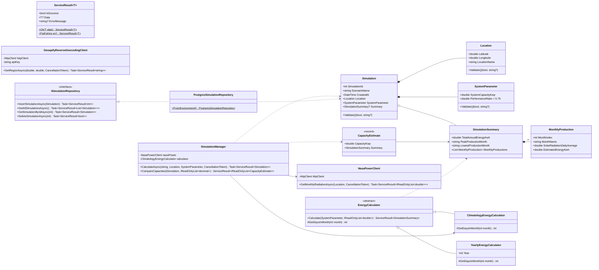

# Class Diagram SolarScope

## Class Diagram Sesuai Implementasi

Diagram ini mengikuti kode di `src/SolarScope.Core` dan menjadi acuan utama. GitHub merender blok Mermaid secara langsung; untuk mengedit, ubah teks di bawah.

Catatan:

- `Simulation` memiliki `Location` dan `SystemParameter` secara komposisi; `Summary` bernilai `null` sampai perhitungan selesai.
- `EnergyCalculator` memakai Template Method: alur 12 bulan sama, sedangkan jumlah hari per bulan ditentukan subclass.
- Semua operasi yang dapat gagal mengembalikan `ServiceResult<T>` sehingga UI tidak menerima exception mentah.
- Implementasi `ISimulationRepository` lain di project Desktop (`UnavailableSimulationRepository`) dan test (`TestSimulationRepository`) tidak digambar.

## Arsip Rancangan Minggu 2

Gambar berikut adalah rancangan awal sebelum implementasi dan dipertahankan sebagai arsip.

### Versi sederhana

Menampilkan `Simulation`, `Location`, `SystemParameter`, `SolarRadiationData`, `SimulationSummary`, dan `MonthlyProduction`.

### Versi dengan method

Menampilkan `Simulasi`, `Lokasi`, `SistemPanelSurya`, `HasilEstimasi`, `NasaPowerApiClient`, `SolarRadianceData`, `AnalyticsEngine`, dan `RiwayatSimulasi`.

### Pemetaan rancangan ke implementasi

| Rancangan Minggu 2 | Implementasi |
| :--- | :--- |
| `Simulasi` (ID `string`) | `Simulation` (ID `int`, identity PostgreSQL) |
| `Lokasi` | `Location` |
| `SistemPanelSurya` | `SystemParameter` |
| `HasilEstimasi` | `SimulationSummary` + `MonthlyProduction` |
| `SolarRadiationData` / `SolarRadianceData` | Tidak dibuat sebagai class; radiasi disimpan di `MonthlyProduction.SolarRadiationDailyAverage` |
| `NasaPowerApiClient` | `NasaPowerClient` |
| `AnalyticsEngine` | `EnergyCalculator` dan turunannya |
| `RiwayatSimulasi` | `ISimulationRepository` / `PostgresSimulationRepository` |
