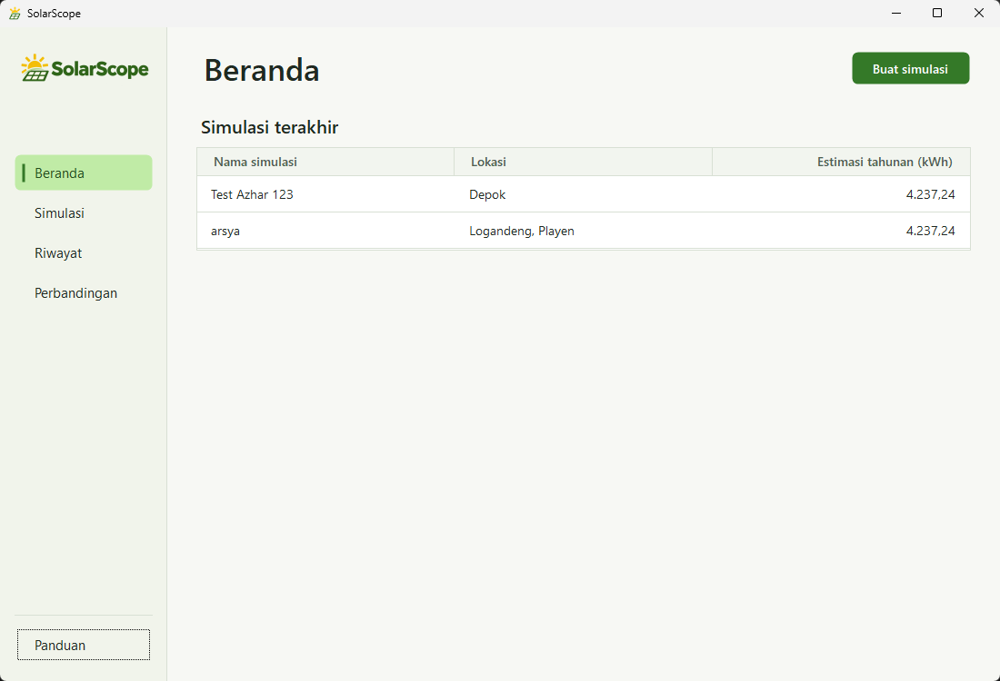
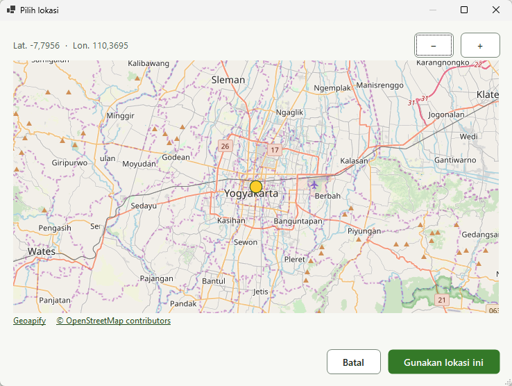
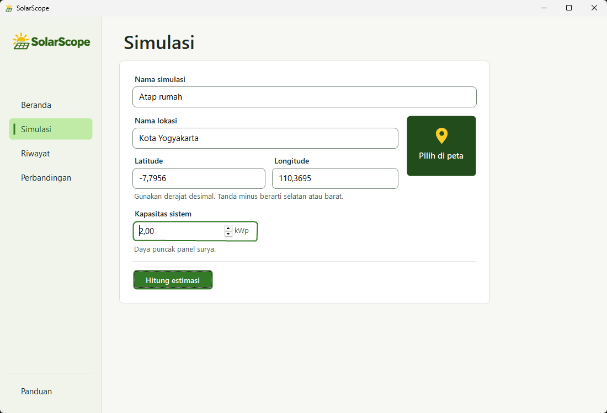
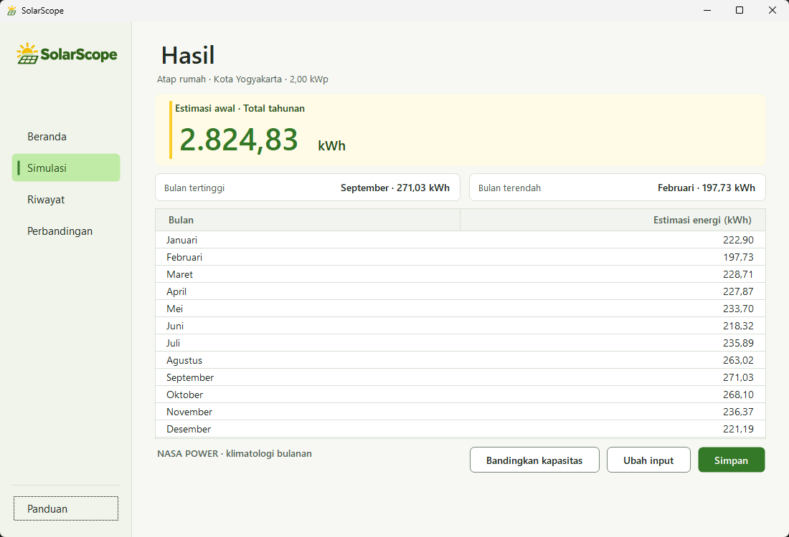
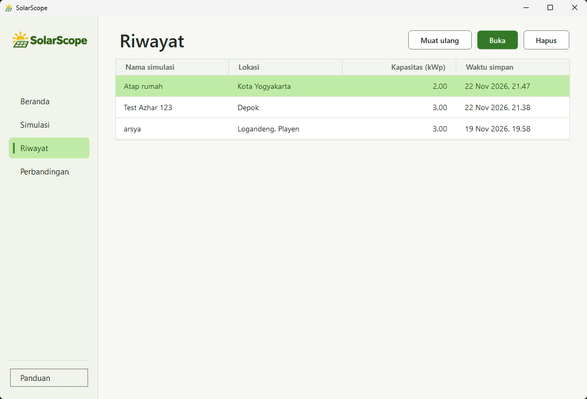
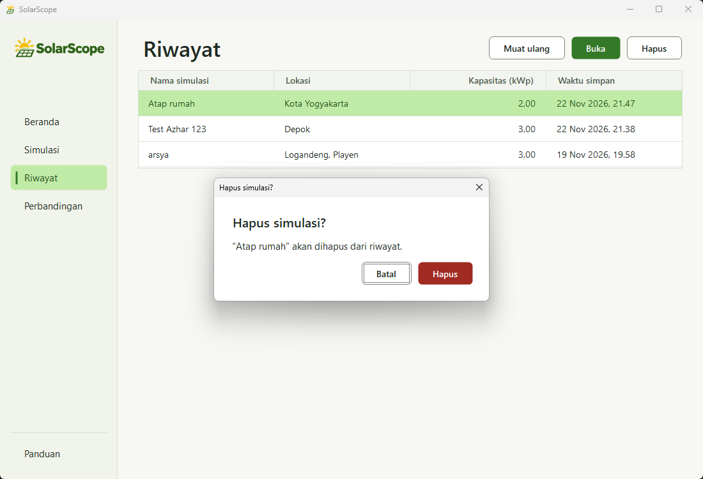
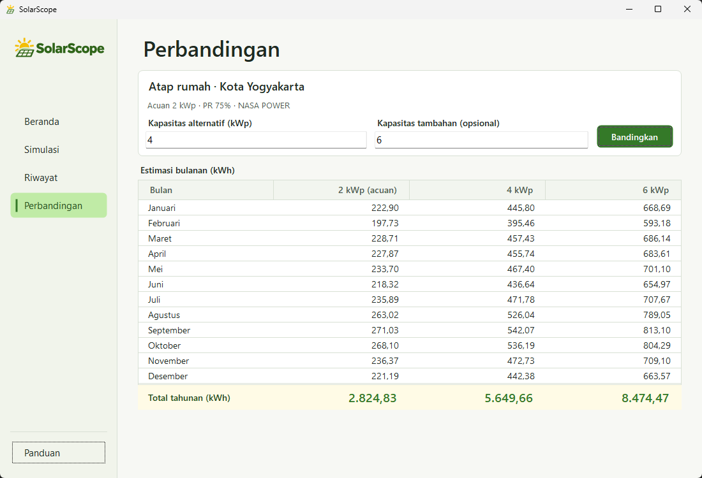
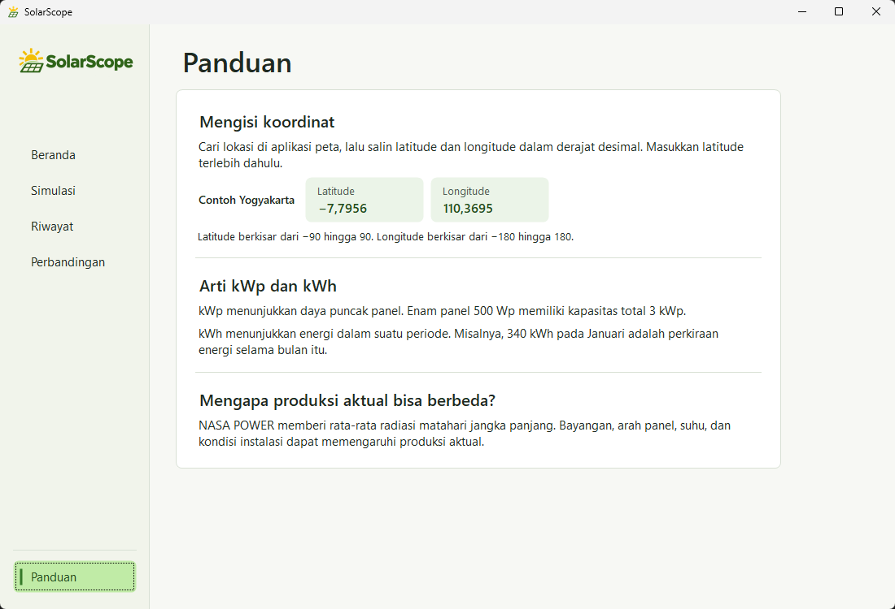

# 2. Panduan Pengguna

Menu utama ada di panel kiri: **Beranda**, **Simulasi**, **Riwayat**, dan **Perbandingan**. Menu **Panduan** ada di bagian bawah panel.

## Alur Singkat

```text
Simulasi (isi data) ─► Hitung estimasi ─► Hasil ─► Simpan ─► Riwayat
                                            └────► Bandingkan kapasitas ─► Perbandingan
```

## Beranda



- Menampilkan **Simulasi terakhir** yang tersimpan beserta estimasi tahunannya.
- Tombol **Buat simulasi** membuka halaman Simulasi.

## Membuat Simulasi

1. Buka menu **Simulasi** (atau klik **Buat simulasi**).
2. Isi **Nama simulasi**, misalnya `Atap rumah`.
3. Isi lokasi dengan salah satu cara:
   - **Manual:** isi **Nama lokasi**, **Latitude**, dan **Longitude** dalam derajat desimal. Tanda minus berarti selatan atau barat. Contoh Yogyakarta: latitude `-7,7956`, longitude `110,3695`.
   - **Dari peta:** klik **Pilih di peta**, klik titik di peta (gunakan **+** dan **−** untuk zoom), lalu klik **Gunakan lokasi ini**. Latitude, longitude, dan **Nama lokasi** terisi otomatis (misalnya "Kota Yogyakarta").
4. Isi **Kapasitas sistem dalam kWp**, misalnya `2`.
5. Klik **Hitung estimasi**. Aplikasi menampilkan "Mengambil data radiasi dari NASA POWER…" lalu membuka halaman Hasil.





Jika ada isian yang salah, pesan muncul di bawah kolom tersebut, misalnya "Nama simulasi wajib diisi." atau "Masukkan Latitude antara −90 dan 90.".

## Membaca Hasil



- **Estimasi awal · Total tahunan**: perkiraan energi satu tahun dalam kWh.
- **Bulan tertinggi** dan **Bulan terendah**: bulan dengan produksi terbesar dan terkecil.
- **Tabel bulanan**: estimasi energi (kWh) untuk Januari sampai Desember.
- **Simpan**: menyimpan hasil ke Riwayat. Setelah berhasil, tombol berubah menjadi **Tersimpan** dan muncul "Tersimpan di Riwayat.".
- **Ubah input**: kembali ke halaman Simulasi dengan data sebelumnya.
- **Bandingkan kapasitas**: membuka halaman Perbandingan memakai hasil ini sebagai acuan.

## Riwayat



- Daftar semua simulasi yang tersimpan.
- Pilih satu baris lalu klik **Buka** untuk melihat hasilnya kembali.
- Pilih satu baris lalu klik **Hapus**. Konfirmasi "Hapus simulasi?" muncul, klik **Hapus** untuk menghapus atau **Batal** untuk membatalkan.
- **Muat ulang** mengambil ulang daftar dari database.



## Perbandingan Kapasitas



1. Buka sebuah hasil (dari Simulasi atau Riwayat), lalu klik **Bandingkan kapasitas**, atau buka menu **Perbandingan**.
2. Isi **Kapasitas alternatif (kWp)**, dan bila perlu **Kapasitas tambahan (opsional)**.
3. Klik **Bandingkan**. Tabel menampilkan estimasi bulanan dan **Total tahunan (kWh)** untuk kapasitas acuan dan tiap kapasitas alternatif.

Aturan: kapasitas antara 0,01 dan 10.000 kWp, maksimal dua angka desimal, dan tiap kapasitas harus berbeda. Perbandingan tidak memanggil internet lagi karena memakai data radiasi dari simulasi acuan.

## Panduan



Berisi penjelasan cara mengisi koordinat, arti kWp dan kWh, contoh Yogyakarta, serta alasan produksi aktual bisa berbeda dari estimasi.

## Catatan Penting

Hasil SolarScope adalah **estimasi awal**, bukan jaminan produksi. Bayangan, arah dan kemiringan panel, suhu, debu, serta kualitas instalasi dapat membuat hasil aktual berbeda.
