# 4. Black Box Testing

Pengujian fungsional dengan teknik Black Box sesuai format Lab 10.2. Pengujian dijalankan pada aplikasi hasil instalasi `SolarScope-Setup.exe`, bukan dari source code.

| Nama Aplikasi | SolarScope 1.0.0 | Tanggal Pengujian | ____________ |
| --- | --- | --- | --- |
| | | **Tester** | ____________ |

Data uji utama: nama `Atap rumah`, lokasi `Yogyakarta`, latitude `-7,7956`, longitude `110,3695`, kapasitas `2` kWp. Nilai acuan dari NASA POWER: total tahunan **2.824,83 kWh**, bulan tertinggi **September**, bulan terendah **Februari**.

| No. | Halaman Yang Diuji | Aksi Aktor | Reaksi Sistem (Benar) | Reaksi Sistem (Salah) | Hasil |
| --- | --- | --- | --- | --- | --- |
| **A.** | **Instalasi dan Konfigurasi** | | | | |
| 1 | Installer | Menjalankan `SolarScope-Setup.exe` lalu mengikuti wizard sampai Finish | Aplikasi terpasang tanpa meminta hak admin dan tanpa memasang .NET | Instalasi gagal atau meminta komponen tambahan | Sesuai ( ) Tidak Sesuai ( ) |
| 2 | Shortcut | Membuka SolarScope dari Start Menu dan dari shortcut desktop | Aplikasi terbuka dengan splash lalu halaman Beranda | Shortcut tidak ada atau aplikasi tidak terbuka | Sesuai ( ) Tidak Sesuai ( ) |
| 3 | Konfigurasi bawaan | Membuka aplikasi tanpa mengatur apa pun | Riwayat dan peta langsung berfungsi memakai `solarscope.settings.json` bawaan | Muncul pesan database atau peta belum dikonfigurasi | Sesuai ( ) Tidak Sesuai ( ) |
| 4 | Uninstall | Uninstall melalui Settings > Apps | Aplikasi dan shortcut terhapus | Berkas atau shortcut tertinggal | Sesuai ( ) Tidak Sesuai ( ) |
| **B.** | **Beranda dan Navigasi** | | | | |
| 1 | Beranda | Membuka aplikasi | Tampil daftar Simulasi terakhir dari database | Daftar tidak tampil atau aplikasi error | Sesuai ( ) Tidak Sesuai ( ) |
| 2 | Navigasi | Mengklik menu Beranda, Simulasi, Riwayat, Perbandingan, Panduan bergantian | Halaman berganti sesuai menu dan menu aktif ditandai | Halaman tidak berganti atau salah halaman | Sesuai ( ) Tidak Sesuai ( ) |
| 3 | Beranda | Mengklik **Buat simulasi** | Halaman Simulasi terbuka | Tidak berpindah halaman | Sesuai ( ) Tidak Sesuai ( ) |
| **C.** | **Simulasi** | | | | |
| 1 | Input valid | Mengisi data uji utama lalu klik **Hitung estimasi** | Muncul "Mengambil data radiasi dari NASA POWER…" lalu halaman Hasil terbuka | Tidak ada hasil atau aplikasi error | Sesuai ( ) Tidak Sesuai ( ) |
| 2 | Nama kosong | Mengosongkan Nama simulasi lalu klik **Hitung estimasi** | Pesan "Nama simulasi wajib diisi." dan tidak ada request | Perhitungan tetap berjalan | Sesuai ( ) Tidak Sesuai ( ) |
| 3 | Lokasi kosong | Mengosongkan Lokasi lalu klik **Hitung estimasi** | Pesan "Lokasi wajib diisi." | Perhitungan tetap berjalan | Sesuai ( ) Tidak Sesuai ( ) |
| 4 | Latitude salah | Mengisi latitude `95` | Pesan "Masukkan Latitude antara −90 dan 90." | Nilai diterima | Sesuai ( ) Tidak Sesuai ( ) |
| 5 | Longitude salah | Mengisi longitude `200` | Pesan "Masukkan Longitude antara −180 dan 180." | Nilai diterima | Sesuai ( ) Tidak Sesuai ( ) |
| 6 | Koordinat bukan angka | Mengisi latitude `abc` | Pesan kesalahan latitude, perhitungan tidak berjalan | Aplikasi error atau nilai diterima | Sesuai ( ) Tidak Sesuai ( ) |
| 7 | Kapasitas nol | Mengisi kapasitas `0` lalu klik **Hitung estimasi** | Pesan "Kapasitas harus lebih dari 0 kWp." | Perhitungan tetap berjalan | Sesuai ( ) Tidak Sesuai ( ) |
| 8 | Pilih di peta | Klik **Pilih di peta**, klik titik Yogyakarta, klik **Gunakan lokasi ini** | Latitude, longitude, dan nama wilayah terisi otomatis | Peta tidak tampil atau isian tidak terisi | Sesuai ( ) Tidak Sesuai ( ) |
| 9 | Batal pilih peta | Membuka peta lalu klik **Batal** | Dialog tertutup, isian lama tidak berubah | Isian berubah atau dialog tidak tertutup | Sesuai ( ) Tidak Sesuai ( ) |
| 10 | Tanpa internet | Mematikan Wi-Fi lalu klik **Hitung estimasi** untuk koordinat baru | Pesan gagal terhubung ke NASA POWER, aplikasi tetap berjalan | Aplikasi crash atau tidak ada pesan | Sesuai ( ) Tidak Sesuai ( ) |
| **D.** | **Hasil** | | | | |
| 1 | Total tahunan | Melihat hasil dari C.1 | Total tahunan 2.824,83 kWh | Total kosong atau berbeda | Sesuai ( ) Tidak Sesuai ( ) |
| 2 | Tabel bulanan | Melihat tabel hasil | 12 baris Januari sampai Desember berisi radiasi dan energi | Baris kurang atau kosong | Sesuai ( ) Tidak Sesuai ( ) |
| 3 | Bulan tertinggi dan terendah | Melihat ringkasan | Bulan tertinggi September, bulan terendah Februari | Bulan tidak sesuai tabel | Sesuai ( ) Tidak Sesuai ( ) |
| 4 | Simpan | Klik **Simpan** | Tombol menjadi **Tersimpan** dan muncul "Tersimpan di Riwayat." | Gagal menyimpan atau tersimpan ganda | Sesuai ( ) Tidak Sesuai ( ) |
| 5 | Ubah input | Klik **Ubah input** | Kembali ke Simulasi dengan isian sebelumnya | Isian hilang | Sesuai ( ) Tidak Sesuai ( ) |
| 6 | Simpan tanpa database | Mematikan Wi-Fi setelah hasil tampil lalu klik **Simpan** | Pesan gagal menyimpan, tombol **Simpan** dapat dicoba lagi | Aplikasi crash atau status tersimpan palsu | Sesuai ( ) Tidak Sesuai ( ) |
| **E.** | **Riwayat** | | | | |
| 1 | Daftar riwayat | Membuka menu **Riwayat** | Simulasi dari D.4 tampil di daftar | Daftar kosong padahal ada data | Sesuai ( ) Tidak Sesuai ( ) |
| 2 | Buka | Memilih baris lalu klik **Buka** | Halaman Hasil menampilkan data yang sama dengan saat disimpan | Data berbeda atau gagal dibuka | Sesuai ( ) Tidak Sesuai ( ) |
| 3 | Batal hapus | Memilih baris, klik **Hapus**, lalu **Batal** | Data tetap ada di daftar | Data terhapus | Sesuai ( ) Tidak Sesuai ( ) |
| 4 | Hapus | Memilih baris, klik **Hapus**, lalu **Hapus** di konfirmasi | Muncul "Simulasi dihapus." dan data hilang dari daftar | Data tidak terhapus | Sesuai ( ) Tidak Sesuai ( ) |
| 5 | Muat ulang | Klik **Muat ulang** | Daftar diambil ulang dari database | Daftar tidak diperbarui | Sesuai ( ) Tidak Sesuai ( ) |
| **F.** | **Perbandingan** | | | | |
| 1 | Tanpa acuan | Membuka menu **Perbandingan** sebelum ada hasil | Pesan "Buka satu hasil simulasi untuk membandingkan kapasitas." | Halaman error | Sesuai ( ) Tidak Sesuai ( ) |
| 2 | Satu alternatif | Dari hasil C.1 klik **Bandingkan kapasitas**, isi `4`, klik **Bandingkan** | Tabel 2 kWp dan 4 kWp, total 4 kWp 5.649,66 kWh | Tabel tidak tampil atau total salah | Sesuai ( ) Tidak Sesuai ( ) |
| 3 | Dua alternatif | Isi `4` dan `6`, klik **Bandingkan** | Tabel tiga kolom kapasitas | Kolom kurang | Sesuai ( ) Tidak Sesuai ( ) |
| 4 | Kapasitas sama | Isi `2` (sama dengan acuan) | Pesan "Setiap kapasitas harus berbeda." | Perbandingan tetap berjalan | Sesuai ( ) Tidak Sesuai ( ) |
| 5 | Di luar rentang | Isi `20000` | Pesan "Kapasitas alternatif harus antara 0,01 dan 10.000 kWp dengan maksimal dua angka desimal." | Nilai diterima | Sesuai ( ) Tidak Sesuai ( ) |
| **G.** | **Panduan** | | | | |
| 1 | Panduan | Klik menu **Panduan** | Tampil penjelasan koordinat, kWp dan kWh, contoh Yogyakarta, dan batasan estimasi | Halaman kosong | Sesuai ( ) Tidak Sesuai ( ) |

## Ringkasan Hasil

| Kelompok | Jumlah kasus | Sesuai | Tidak Sesuai |
| --- | --- | --- | --- |
| A. Instalasi dan Konfigurasi | 4 | | |
| B. Beranda dan Navigasi | 3 | | |
| C. Simulasi | 10 | | |
| D. Hasil | 6 | | |
| E. Riwayat | 5 | | |
| F. Perbandingan | 5 | | |
| G. Panduan | 1 | | |
| **Total** | **34** | | |

## Temuan dan Perbaikan (Sanity Testing)

Smoke test pertama menemukan dua cacat. Keduanya diperbaiki lalu diuji ulang (sanity testing) sebelum worksheet di atas diisi.

| No. | Temuan | Penyebab | Perbaikan | Uji ulang |
| --- | --- | --- | --- | --- |
| 1 | Peta gagal dimuat dan **Hitung estimasi** timeout pada percobaan pertama, baru berhasil setelah diulang | `HttpClient` bawaan .NET mencoba alamat IPv6 lebih dulu dan menunggu sekitar 21 detik bila jalur IPv6 jaringan macet, melebihi batas waktu peta (8 detik) dan NASA POWER (15 detik) | `FastFallbackHttp`: koneksi bergaya Happy Eyeballs (RFC 8305), alamat berikutnya (IPv4) dicoba 250 ms kemudian dan koneksi pertama yang berhasil dipakai | Peta dan estimasi berhasil pada percobaan pertama. Uji otomatis: alamat macet beralih ke alamat berikutnya dalam sekitar 0,3 detik |
| 2 | Dialog **Hapus simulasi?** tampil sangat sempit, tombol **Batal** dan **Hapus** tidak terlihat | Form `AutoSize` mode `GrowAndShrink` menyusut ke lebar minimum layout | Mode diganti `GrowOnly` sehingga ukuran 430 px menjadi batas minimum | Dialog tampil utuh (lihat gambar 10) |

## Lampiran: Bukti Pengujian

| Gambar | Kasus |
| --- | --- |
| 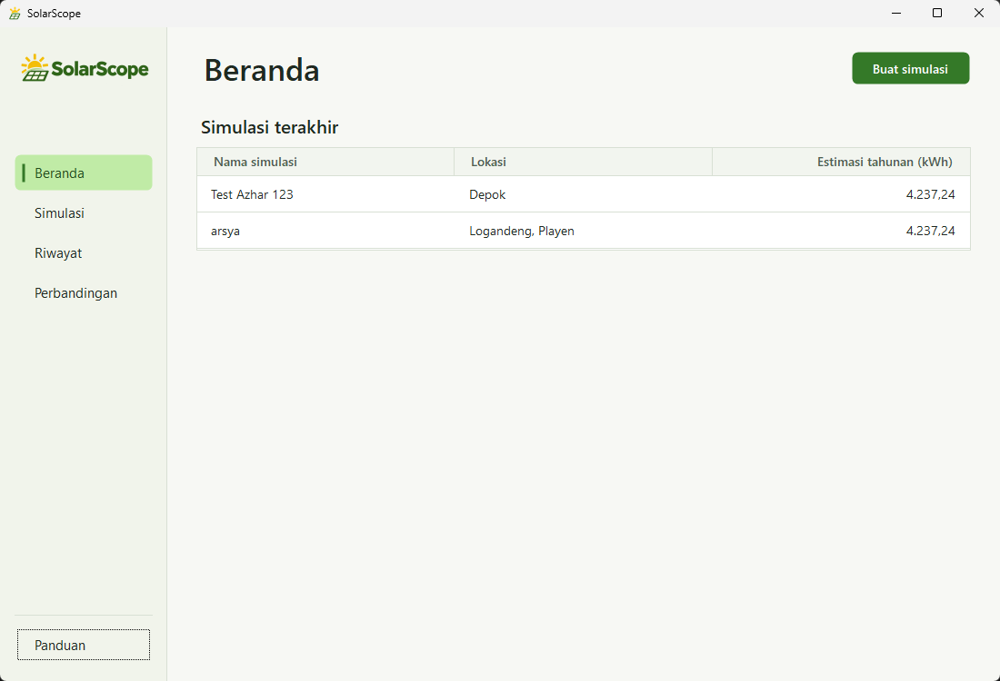 | B.1 Beranda menampilkan simulasi terakhir |
| 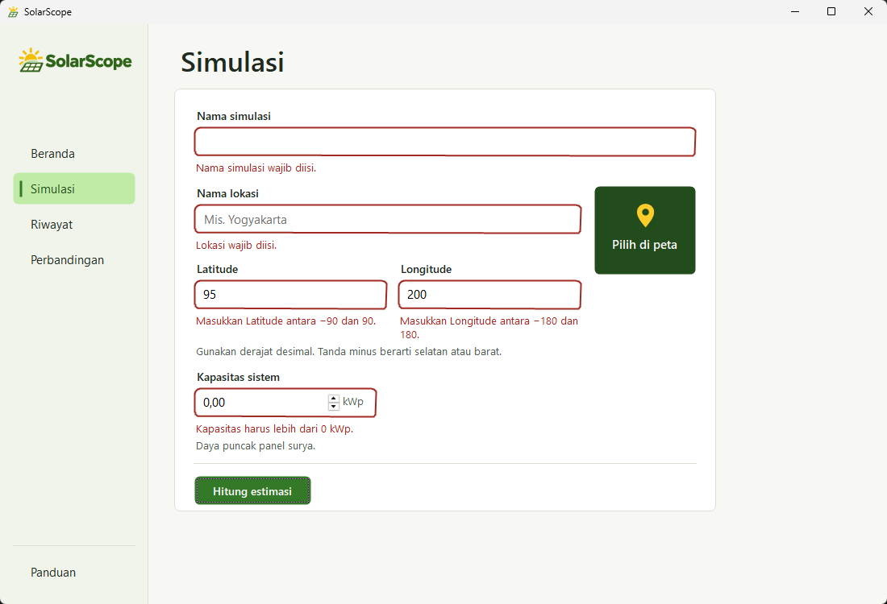 | C.2 sampai C.7 Pesan validasi input |
| 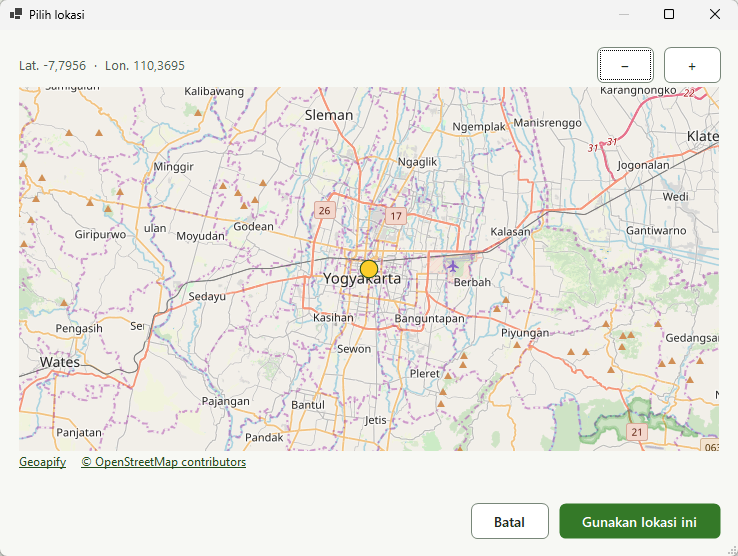 | C.8 Pilih lokasi di peta |
| 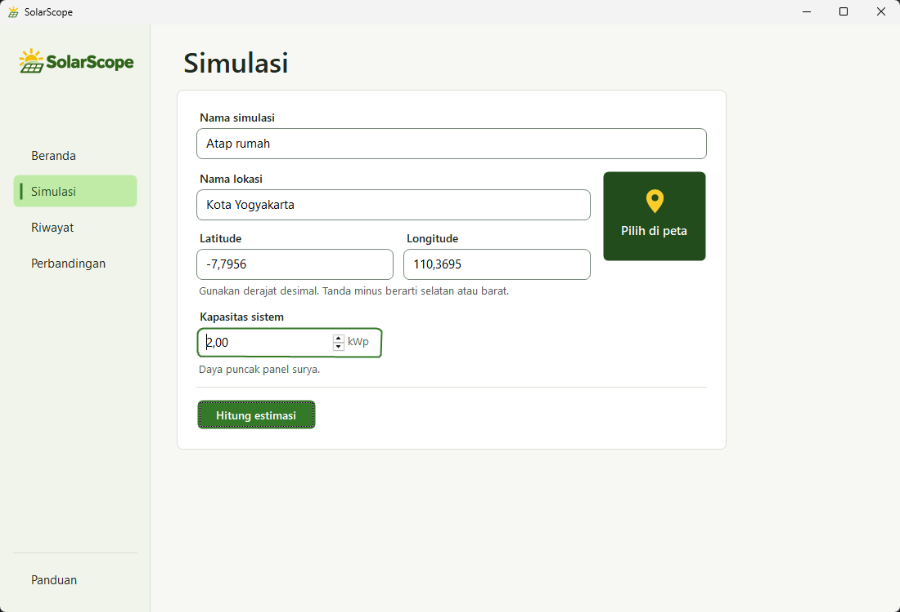 | C.8 Nama lokasi dan koordinat terisi otomatis |
| 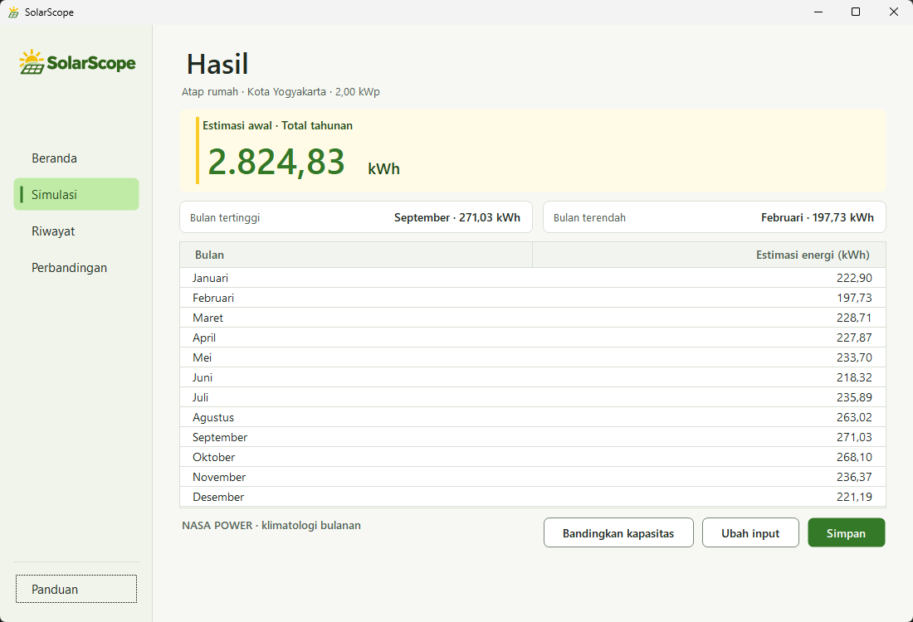 | C.1, D.1 sampai D.3 Hasil estimasi Yogyakarta 2 kWp |
| 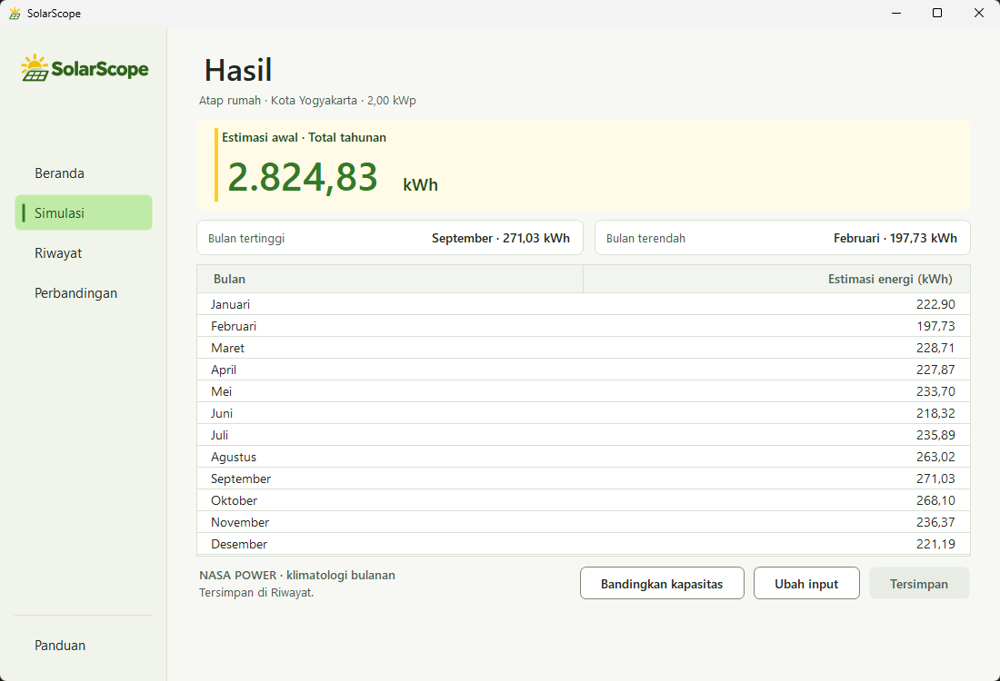 | D.4 Simpan ke riwayat |
| 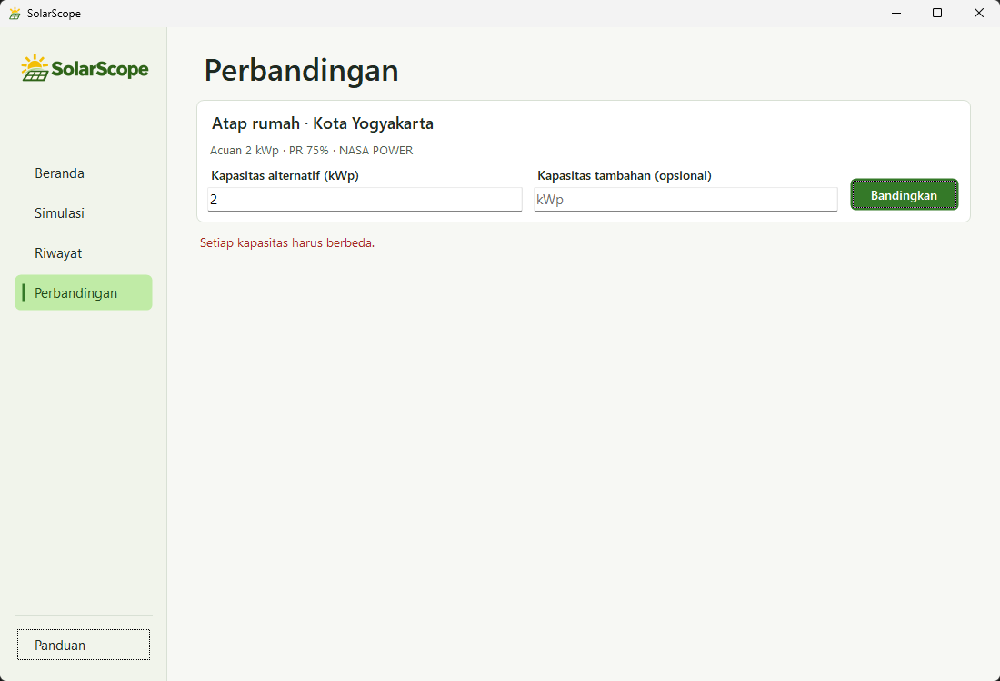 | F.4 Kapasitas sama ditolak |
| 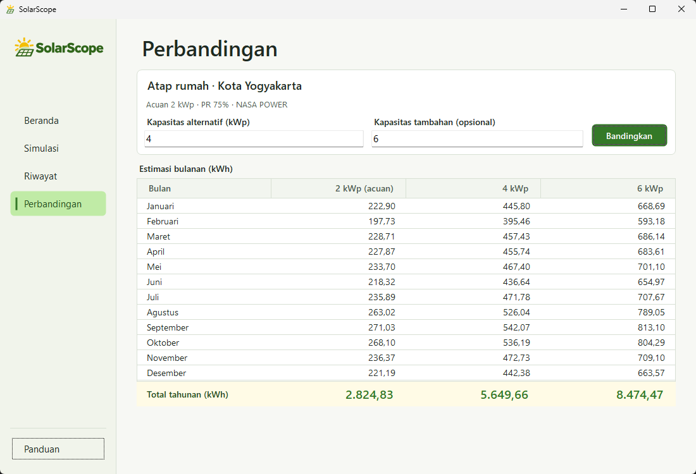 | F.2 dan F.3 Perbandingan 2, 4, dan 6 kWp |
| 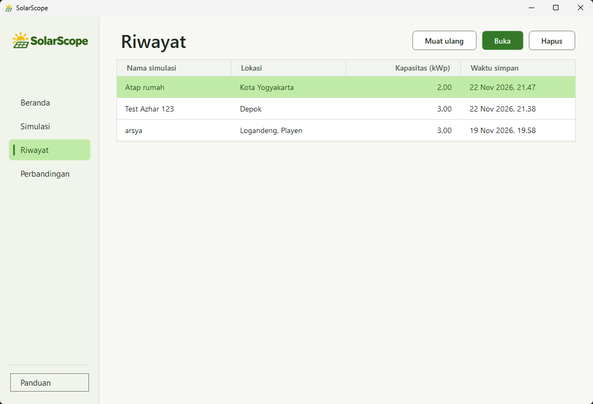 | E.1 Daftar riwayat |
| 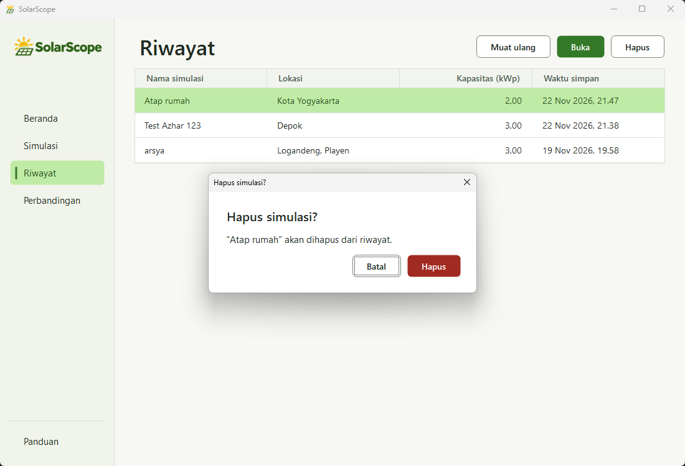 | E.3 dan E.4 Konfirmasi hapus |
| 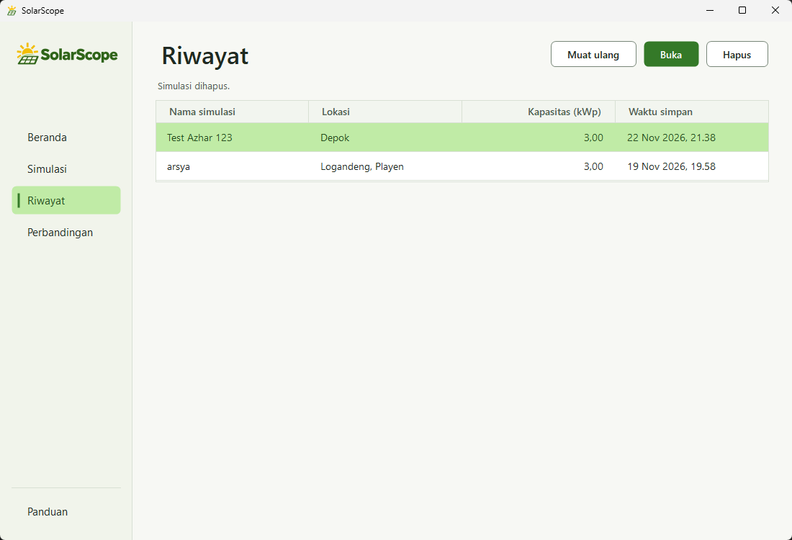 | E.4 Simulasi dihapus |
| 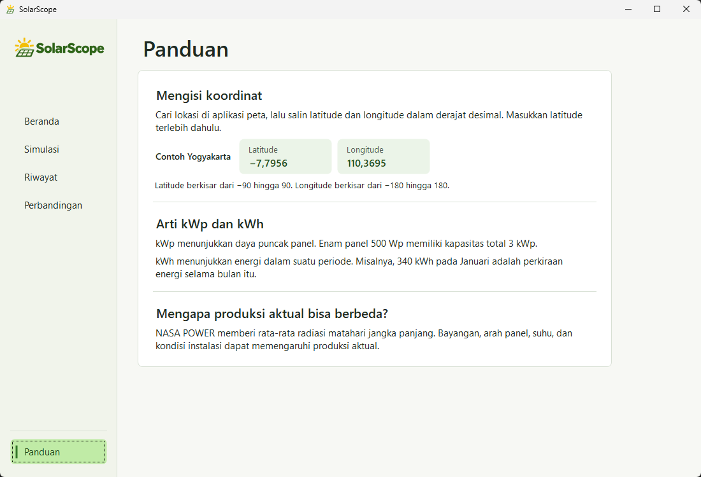 | G.1 Halaman Panduan |

## Lampiran: Pengujian Otomatis

Selain black box manual, tim menjalankan verifikasi otomatis (unit dan integration testing) dari source code:

| Perintah | Cakupan | Hasil |
| --- | --- | --- |
| `dotnet run --project tests/SolarScope.Core.Verification` | Rumus energi, validasi input, parsing dan error NASA POWER, Geoapify, cache, koneksi cepat IPv6/IPv4, `SimulationManager`, perbandingan, simpan-baca-hapus ke Supabase | 69 check lulus |
| `dotnet run --project tests/SolarScope.Desktop.Verification` | Konfigurasi `solarscope.settings.json`, navigasi, alur simulasi sampai simpan, riwayat, perbandingan | 68 check lulus |
| `dotnet run --project tests/SolarScope.Desktop.Verification -- --map` | Dialog peta dengan respons Geoapify tiruan | Lulus |
